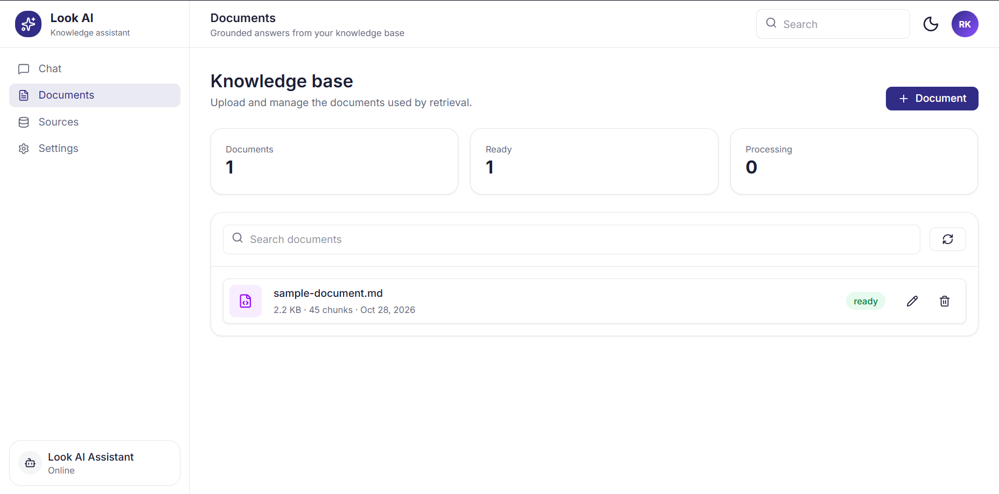
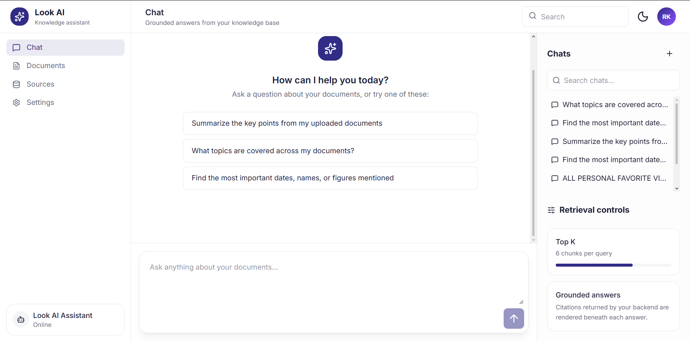

# Look RAG

A full-stack Hybrid Retrieval-Augmented Generation (RAG) chat workspace built with React and FastAPI.

## Purpose

Look RAG lets you upload your own documents and chat with them. Uploaded files are split into chunks, embedded and stored in PostgreSQL (pgvector). When you ask a question, the most relevant chunks are retrieved and passed to an LLM, which streams back an answer grounded in your documents.

## Tech Stack

| Folder | Description | Tech |
|--------|-------------|------|
| `backend/` | REST API, RAG pipeline | FastAPI, PostgreSQL, pgvector, SQLAlchemy (async), Redis, JWT, Sentence Transformers, OpenAI-compatible LLM, Cloudinary |
| `frontend/` | Web client | React, TypeScript, Vite, Tailwind CSS, Radix UI, TanStack Query, Axios |

## Features

**Chat**
- Streaming answers, rendered as Markdown as they arrive
- Chat history with search, and reopening past conversations
- Suggested prompts on an empty chat

**Documents**
- Multi-file upload with rename and delete
- Files stored in Cloudinary

**RAG pipeline**
- Loading and validation
- Chunking
- Embedding (Sentence Transformers)
- Ingestion into pgvector
- Hybrid retrieval (vector and keyword search)
- Reranking
- Prompt building
- Answer generation

**Auth**
- Login and logout with JWT access and refresh tokens in HTTP-only cookies
- Optional Redis caching

## Screens




## Project Structure

```
look-rag/
├── backend/
│   ├── pyproject.toml          # dependencies (managed with uv)
│   ├── start.sh                # starts the dev server
│   └── src/
│       ├── app/
│       │   ├── main.py         # FastAPI app, CORS, auth middleware
│       │   ├── api/v1/         # routes: auth, chat, document, query, health
│       │   ├── core/           # settings (env config)
│       │   ├── db/             # engine/session and models (user, chat, message, document, assistant)
│       │   ├── schemas/        # Pydantic request/response models
│       │   ├── services/       # business logic (auth, chat, message, assistant, llm)
│       │   ├── pipeline/       # loader, chunking, embedding, ingestion, retrieval, context builder, generator
│       │   ├── llm/            # LLM provider abstraction and OpenAI client
│       │   ├── prompts/        # prompt templates
│       │   └── utils/          # jwt, security, redis, auth middleware, helpers
│       └── tests/
├── frontend/
│   ├── package.json
│   └── src/
│       ├── pages/              # Login, Chat, Documents, Sources, Settings
│       ├── components/         # ChatPanel, Login, shared components
│       ├── features/           # admin and user feature modules
│       ├── services/apis/      # axios client, endpoints, API functions
│       ├── routes/  providers/  config/  lib/  utils/  test/
│       └── types.ts
└── README.md
```

## Installation

### Prerequisites

- Python 3.11 or newer and [uv](https://docs.astral.sh/uv/)
- Node.js 18 or newer and npm
- PostgreSQL with the [pgvector](https://github.com/pgvector/pgvector) extension available
- Redis (optional, only if `REDIS_ENABLED=true`)
- An OpenAI-compatible API key (OpenAI or OpenRouter) and a Cloudinary account

### 1. Clone

```bash
git clone <repo-url>
cd look-rag
```

### 2. Backend

```bash
cd backend
uv sync
```

Create `backend/.env`:

```env
DATABASE_URL=<YOUR_DB_URL>

OPENAI_API_KEY=
OPENAI_CHAT_MODEL=gpt-4o-mini
OPENROUTER_BASE_URL=
OPENROUTER_API_KEY=
EMBEDDING_MODEL=all-MiniLM-L6-v2

JWT_SECRET_KEY=change-me
JWT_ALGORITHM=HS256
JWT_ACCESS_TOKEN_LIFETIME_HOURS=8
JWT_REFRESH_TOKEN_LIFETIME_DAYS=4

CLOUDINARY_CLOUD_NAME=<CLOUD_NAME>
CLOUDINARY_API_KEY=<CLOUD_API_KEY>
CLOUDINARY_API_SEC_KEY=<CLOUD_API_SECRET>

REDIS_ENABLED=false
REDIS_HOST=localhost
REDIS_PORT=6379
```

Create the database. Tables and the `vector` extension are created automatically on startup:

```bash
createdb look_rag
```

The chat endpoint looks up an assistant named `Look AI` in the `assistants` table, so insert that row before chatting.

Start the API:

```bash
sh start.sh
# or: uv run fastapi dev src/app/main.py
```

The API runs at http://localhost:8000 (docs at http://localhost:8000/docs).

### 3. Frontend

```bash
cd frontend
npm install
```

Create `frontend/.env`:

```env
VITE_API_BASE_URL=http://localhost:8000
```

The client adds `/api/v1` itself, so don't include it here.

Start the dev server:

```bash
npm run dev
```

The app runs at http://localhost:5173. Other scripts: `npm run build`, `npm run preview`, `npm test`.

### 4. Tests

```bash
cd backend && uv run pytest
cd frontend && npm test
```
